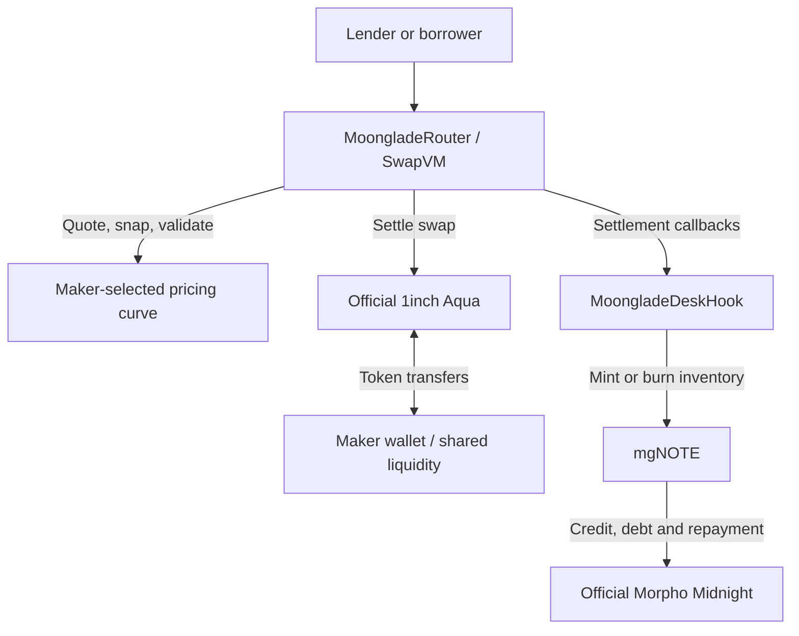

# Moonglade

**A bond desk for Morpho Midnight, built on 1inch Aqua and SwapVM.**

Buy fixed-maturity credit with USDC. Sell it to exit early. Borrow against your collateral through the same swap, even when you start with no notes.

Moonglade turns Midnight credit into **mgNOTE**, a transferable ERC-20, and gives it a market where makers quote from their own wallets. Inventory is minted when a trade needs it.

**ETHGlobal Mumbai 2026** · Base fork · Solidity / Foundry

[Run the demo](#run-the-demo) · [Verified output](demo/output.txt) · [Whitepaper](docs/Moonglade-Whitepaper.pdf) · [Contract map](#contract-map)

## Why build this?

A fixed-rate loan needs a counterparty. Lenders exiting early and borrowers seeking cash depend on available offers at their size and rate. Credit held as a protocol ledger entry is also difficult for other applications to use.

Moonglade adds a continuously priced desk beside Midnight's book: tradable credit for lenders, immediate quotes against funded liquidity for borrowers, and a maker-chosen curve backed by shared wallet liquidity.

## One desk, both sides of credit

| Action | User does | Protocol does |
| --- | --- | --- |
| **Lend** | Swap USDC → mgNOTE | Mint missing inventory from the maker's Midnight position and deliver the notes. |
| **Exit early** | Swap mgNOTE → USDC | Pay the lender; retain notes as inventory or burn them to cancel maker debt. |
| **Borrow** | Swap mgNOTE → USDC while holding no notes | Mint the authorized shortfall against borrower collateral, then sell it in the same transaction. |
| **Redeem** | Redeem mgNOTE after maturity | Burn shares for their proportional backing, paid from repaid Midnight credit. |

Borrowers first supply collateral and approve an expiring mint budget. mgNOTE represents **net credit after pending continuous fees**, with Midnight losses reflected in its backing.

## Why Aqua and SwapVM matter

**Aqua supplies shared wallet liquidity.** Makers register virtual budgets with `Aqua.ship()`. Idle swap assets stay in their wallet and can serve multiple strategies. Actual balances and allowances bound settlement; required collateral goes to Midnight.

**SwapVM makes credit programmable.** The custom `MoongladeSwap` opcode quotes a maker-selected curve, snaps to Midnight's tick grid with maker-favored rounding, and validates the final amounts. The included YieldSpace curve prices time and inventory; makers can supply another `IMoongladeCurve` implementation.

**Settlement hooks create inventory inside the swap.** `preTransferOut` mints missing maker inventory, `preTransferIn` mints a borrower's authorized shortfall, and `postTransferIn` optionally cancels maker debt. Borrowing needs no separate borrower adapter.



## Run the demo

Install [Foundry](https://getfoundry.sh/) with support for Solidity **0.8.30**, **0.8.34**, and the **Osaka** EVM target. From the repository root:

```bash
forge soldeer install
forge build
bash demo/run.sh
```

The runner prints common configuration once, then executes six independent scenarios:

| Scene | What you can verify |
| --- | --- |
| `maker` | Register a desk; its initial 1,000,000 USDC remains in the maker wallet. |
| `lend` | Swap 10,000 USDC for **10,394.873165 mgNOTE**, minted on demand. |
| `sell` | Exit that position after seven days for **10,007.526927 USDC**; cancel maker debt and release collateral. |
| `borrow` | Start with zero notes and receive **9,605.221000 USDC** against borrower collateral. |
| `maturity` | Repay the maker's debt and redeem the lender's notes for **10,394.873165 USDC**. |
| `shared` | Fill two strategies against **one maker wallet**, with no duplicate deposits. |

Run one scene with `bash demo/run.sh borrow`. Override the public RPC with `BASE_RPC_URL=https://your-base-rpc bash demo/run.sh`.

The demo forks **Base block 52,000,000** and calls official deployed Aqua and Midnight contracts. Moonglade contracts deploy locally. Opening balances, a fixed $2,000/WETH oracle, custom-market governance configuration, and time travel are fork fixtures. Each scene starts fresh; no transactions are broadcast. Maturity repayment comes from maker cash.

## Contract map

| Component | Responsibility |
| --- | --- |
| [`MoongladeNote`](src/note/MoongladeNote.sol) | Market-specific ERC-20 shares; mint, debt repayment, offer wrapping/unwrapping, and redemption. |
| [`Factory`](src/note/MoongladeNoteFactory.sol) + [`Ratifier`](src/note/MoongladeNoteRatifier.sol) | Deterministic, permissionless note deployment; exact internal-offer authorization. |
| [`MoongladeSwap`](src/instructions/MoongladeSwap.sol) + [`Program`](src/libraries/MoongladeProgram.sol) | Custom opcode `0xd0` and its canonical SwapVM program. |
| [`MoongladeRouter`](src/routers/MoongladeRouter.sol) | SwapVM router with the Moonglade instruction set and Aqua settlement. |
| [`YieldSpaceCurve`](src/curves/YieldSpaceCurve.sol) | Reference time-aware pricing behind the pluggable curve interface. |
| [`MoongladeDeskHook`](src/hooks/MoongladeDeskHook.sol) | Inventory minting, scoped borrower execution, maker debt cancellation, and collateral management. |

`wrapFromOffer` and `unwrapToOffer` connect mgNOTE to Midnight offers for desk/order-book arbitrage. Each market's note wrapper is ownerless and immutable; makers control their own desk configuration.

---

Built by **[Sahil Gujrati (@mgnfy-view)](https://github.com/mgnfy-view)**. Read the [whitepaper](docs/Moonglade-Whitepaper.pdf) for the full design and economics.

Moonglade's original contributions use the [MIT license](LICENSE.txt); dependencies retain their own terms. See [third-party notices](THIRD_PARTY_NOTICES.md).

Powered by Aqua and SwapVM — © Degensoft Ltd 2025.
