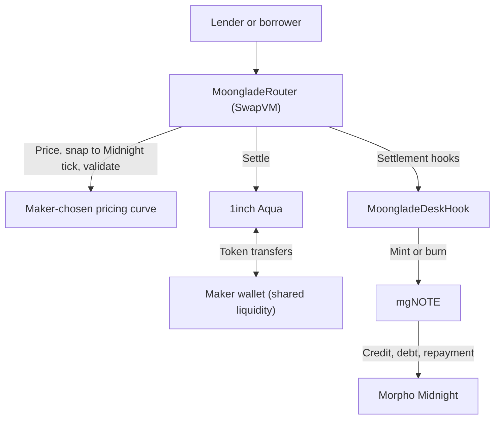

# Moonglade

**Fixed-rate credit, one swap away.** Lend, borrow, or exit early on Morpho Midnight, each in a single swap.

Moonglade is a **1inch Aqua app that makes markets in fixed-rate loans**. Makers run a bond desk from their own wallet: a custom SwapVM instruction prices every trade, settlement hooks create Midnight credit on demand, and lenders hold it as **mgNOTE**, a transferable token worth 1 USDC at maturity.

**ETHGlobal Mumbai 2026 · 1inch: Build an Aqua App** · Base fork · Solidity / Foundry

[How it works](#how-it-works) · [Run the demo](#run-the-demo) · [Verified output](demo/output.txt) · [Whitepaper](docs/Moonglade-Whitepaper.pdf)

---

## The problem

Morpho Midnight offers fixed-rate, fixed-term loans through an order book. That works when someone is quoting, and only then:

- **Lenders are locked in** until maturity unless a buyer happens to have an offer posted at their size and rate.
- **Borrowers wait** for a lender to take their offer.
- **Providing liquidity means running bots** that sign and refresh offers around the clock.
- **Credit lives inside a protocol ledger**, so other apps can't hold, trade, or build on it.

## The solution

Moonglade adds the **AMM half** of the market beside Midnight's order book:

| Who | What they get |
| --- | --- |
| **Lenders** | Lock a fixed rate in one swap, and exit any time before maturity in another |
| **Borrowers** | Borrow instantly against their own collateral, in one swap, with collateral and debt staying in their own Midnight account |
| **Makers** | Earn swap fees and the tick spread on every fixed-rate swap, plus interest on long inventory, by shipping a curve once, with no bots |
| **Arbitrageurs** | Profit from rate gaps between desks and Midnight's order book, wrapping or unwrapping Midnight offers in one transaction; their trades keep every desk's rate in line with the market |
| **DeFi** | Fixed-rate credit as a standard ERC-20 that other protocols can list, hold, or use |
| **Midnight** | Every Moonglade trade creates a real Midnight loan, recorded at the tick of the price actually traded |

`wrapFromOffer` and `unwrapToOffer` connect the two venues both ways, so arbitrage keeps the desk's rate in line with Midnight's book, and existing Midnight positions can move into mgNOTE and back.

## How it works

Each desk combines USDC/mgNOTE virtual budgets on Aqua with the maker's collateral and credit position on Midnight. One swap can change both.

| Action | User does | Protocol does |
| --- | --- | --- |
| **Lend** | Swap USDC → mgNOTE | Mints any missing inventory from the maker's Midnight position, then delivers the notes |
| **Exit early** | Swap mgNOTE → USDC | Pays the lender; keeps the notes as inventory or burns them to cancel maker debt |
| **Borrow** | Swap mgNOTE → USDC while holding none | Mints the borrower's authorised shortfall against their own collateral, then sells it, all in the same transaction |
| **Redeem** | Redeem mgNOTE after maturity | Burns shares for their share of repaid Midnight credit |

Borrowers first supply collateral and approve an expiring borrow budget. Lenders can never borrow by accident: without that budget, selling notes you don't hold simply reverts.

### What we built on Aqua and SwapVM

- **Aqua: shared wallet liquidity.** Makers register virtual budgets with `Aqua.ship()`. Idle funds stay in the maker's wallet and can back several strategies at once.
- **SwapVM: a new instruction, `MoongladeSwap` (`0xd0`).** It asks a maker-chosen pricing contract for a price, snaps it to Morpho Midnight's tick grid in the maker's favour, and enforces checks no pricer can bypass (par cap, liquidity, quote equals swap). The bundled `YieldSpaceCurve` prices time and inventory; makers can plug in any `IMoongladeCurve`.
- **Settlement hooks: credit created inside the swap.** `preTransferOut` mints maker inventory, `preTransferIn` mints a borrower's authorised shortfall, `postTransferIn` optionally cancels maker debt. Borrowing needs no separate adapter.

Makers set their own `feeBps` in the YieldSpace curve settings: asks increase and bids decrease by the selected spread. The fee is committed into the shipped strategy and stays with the maker through the execution price. Zero disables it; changing it requires replacing the registered strategy.



## Run the demo

Install [Foundry](https://getfoundry.sh/) with Solidity **0.8.30**, **0.8.34**, and the **Osaka** EVM target. From the repository root:

```bash
forge soldeer install
forge build
bash demo/run.sh            # all scenes
bash demo/run.sh borrow     # one scene
```

Use your own RPC with `BASE_RPC_URL=https://your-base-rpc bash demo/run.sh`.

The demo maker defaults to a 30 bps (0.30%) spread. Choose another rate with `DEMO_TRADE_FEE_BPS=50 bash demo/run.sh`, or use `0` to disable fees.

Swap logs show the embedded maker fee in USDC and the extra tick/rounding spread separately from Midnight settlement costs.

The demo forks **Base block 52,000,000** and calls the **deployed Aqua and Morpho Midnight contracts** with **real USDC and WETH**. Each scene executes real token transfers and then checks balances, debt, and collateral.

| Scene | What you can verify |
| --- | --- |
| `maker` | A desk registers; its 1,000,000 USDC stays in the maker's wallet |
| `lend` | 10,000 USDC buys **10,364.540585 mgNOTE**, minted on demand |
| `sell` | After seven days, the lender exits for **9,947.416539 USDC**; maker debt is cancelled and collateral released |
| `borrow` | A borrower holding zero notes receives **9,573.770000 USDC** against their own collateral |
| `maturity` | The maker repays its debt; the lender redeems **10,364.540585 USDC** |
| `shared` | Two strategies fill against **one maker wallet**, with no duplicate deposits |

**Fixtures, stated plainly:** opening balances, a fixed $2,000/WETH oracle, a custom Midnight market configuration, and time travel are fork fixtures. Moonglade's contracts deploy locally (the custom opcode needs its own router). Each scene starts fresh; nothing is broadcast.

## Contract map

| Component | Responsibility |
| --- | --- |
| [`MoongladeNote`](src/note/MoongladeNote.sol) | ERC-20 shares of Midnight credit: mint, repay, wrap/unwrap offers, redeem |
| [`Factory`](src/note/MoongladeNoteFactory.sol) + [`Ratifier`](src/note/MoongladeNoteRatifier.sol) | Permissionless, deterministic note per market; authorises only the note's own in-flight offer |
| [`MoongladeSwap`](src/instructions/MoongladeSwap.sol) + [`Program`](src/libraries/MoongladeProgram.sol) | Custom opcode `0xd0` and the canonical SwapVM program |
| [`MoongladeRouter`](src/routers/MoongladeRouter.sol) | SwapVM v1.0.2 router extended with the Moonglade instruction |
| [`YieldSpaceCurve`](src/curves/YieldSpaceCurve.sol) | Default time-aware pricing curve behind a pluggable interface |
| [`MoongladeDeskHook`](src/hooks/MoongladeDeskHook.sol) | Just-in-time minting, scoped borrowing, debt cancellation, collateral management |

## Track requirements

| 1inch requirement | Where to see it |
| --- | --- |
| **A custom Aqua app with a sophisticated DeFi position** | A desk managing shared cash, tokenised credit, collateral, and debt across its full lifecycle (`lend`, `sell`, `borrow`, `maturity`) |
| **SwapVM use** | Custom instruction `0xd0` on a router extending SwapVM v1.0.2, plus three settlement hooks; see [router](src/routers/MoongladeRouter.sol) and [opcode table](src/opcodes/MoongladeOpcodes.sol) |
| **Onchain token transfers in the demo** | Every scene moves USDC, WETH, or mgNOTE on a Base fork; see [recorded output](demo/output.txt) |
| **Proper commit history** | Built incrementally during the event; see the commit log |

## Prior art and positioning

- **YieldSpace** (Yield Protocol) inspired the default curve's invariant; Moonglade's implementation is original.
- **Pendle** fixes the yield on assets people already hold; Moonglade creates and trades fixed-rate *loans*, including borrowing.

---

Built by **[Sahil Gujrati (@mgnfy-view)](https://github.com/mgnfy-view)**. Full design and economics in the [whitepaper](docs/Moonglade-Whitepaper.pdf).

Moonglade's original contributions are [MIT-licensed](LICENSE.txt); dependencies keep their own terms ([third-party notices](THIRD_PARTY_NOTICES.md)). Aqua and SwapVM © Degensoft Ltd 2025.
