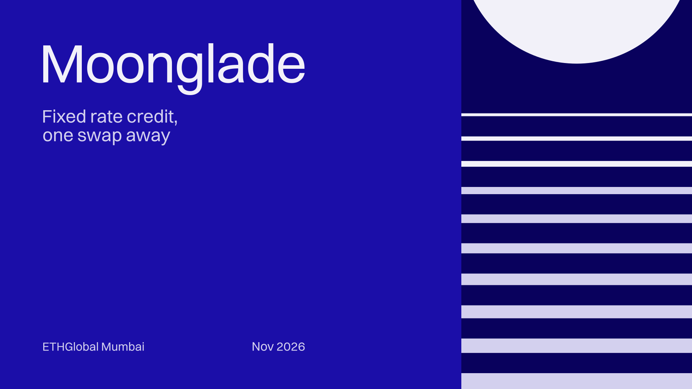
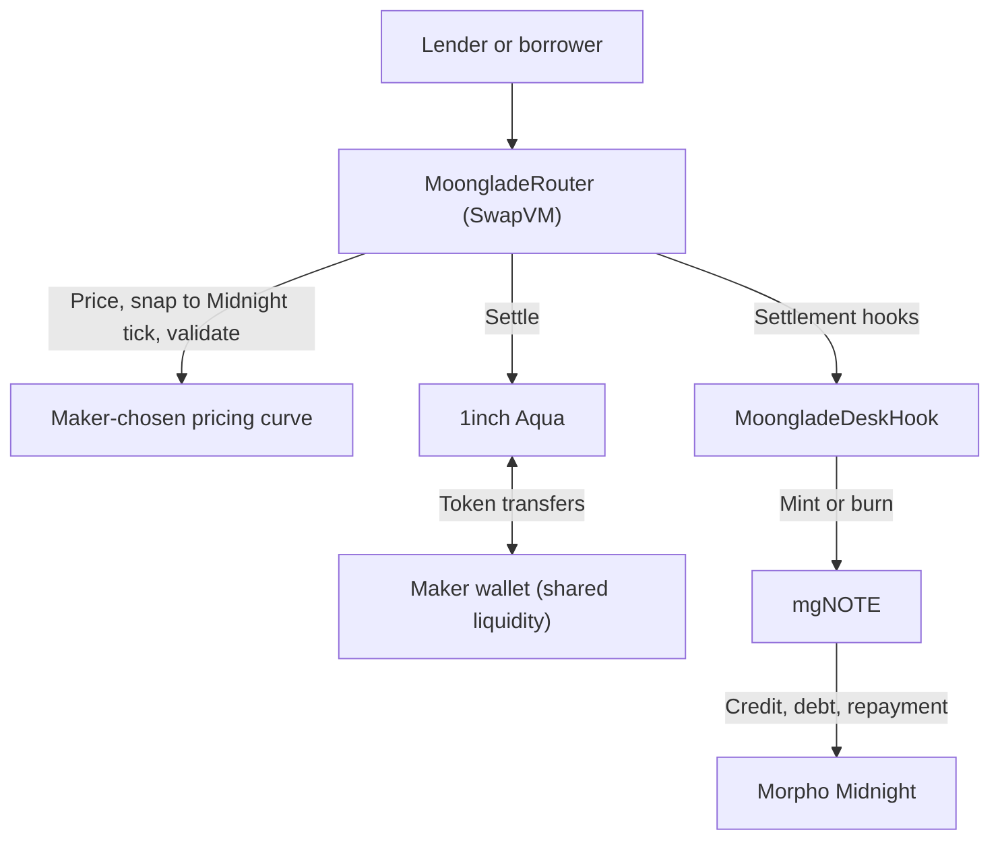

# Moonglade

**Fixed-rate credit, one swap away.** Lend, borrow, or exit early on Morpho Midnight, each in a single swap.

Moonglade is a **1inch Aqua app that makes markets in fixed-rate loans**. Makers run a bond desk from their own wallet:
a custom SwapVM instruction prices every trade, settlement hooks create Midnight credit on demand, and lenders hold it
as **mgNOTE**, a transferable share of that credit.

**ETHGlobal Mumbai 2026 · 1inch: Build an Aqua App** · Base mainnet + fork demo · Solidity / Foundry

[How it works](#how-it-works) · [Live transactions](#live-base-transactions) · [Live Base desk](#base-mainnet-deployment) ·
[Run the demo](#run-the-demo) · [Fork output](demo/output.txt) · [Risks](#risks-and-limitations) ·
[Whitepaper](docs/Moonglade-Whitepaper.pdf)

---

## The problem

Morpho Midnight offers fixed-rate, fixed-term loans through an order book. That works when someone is quoting, and only
then:

- **Lenders are locked in** until maturity unless a buyer happens to have an offer posted at their size and rate.
- **Borrowers wait** for a lender to take their offer.
- **Providing liquidity means running bots** that sign and refresh offers around the clock.
- **Credit lives inside a protocol ledger**, so other apps can't hold, trade, or build on it.

## The solution

Moonglade adds the **AMM half** of the market beside Midnight's order book:

| Who | What they get |
| --- | --- |
| **Lenders** | Lock a fixed rate in one swap, and exit any time before maturity in another |
| **Borrowers** | Borrow instantly against their own collateral, in one swap, with collateral and debt staying in their own Midnight account |
| **Makers** | Earn swap fees and the tick spread on every fixed-rate swap, plus interest on long inventory, by shipping a curve once, with no bots |
| **Arbitrageurs** | Profit from rate gaps between desks and Midnight's order book, wrapping or unwrapping Midnight offers in one transaction; their trades keep every desk's rate in line with the market |
| **DeFi** | Fixed-rate credit as a standard ERC-20 that other protocols can list, hold, or use |
| **Midnight** | Moonglade originates real Midnight loans on demand, at the tick of the price actually traded |

`wrapFromOffer` and `unwrapToOffer` connect the two venues both ways, so arbitrage keeps the desk's rate in line with
Midnight's book, and existing Midnight positions can move into mgNOTE and back.

## How it works

Each desk combines USDC/mgNOTE virtual budgets on Aqua with the maker's collateral and credit position on Midnight. One
swap can change both.

| Action | User does | Protocol does |
| --- | --- | --- |
| **Lend** | Swap USDC → mgNOTE | Mints any missing inventory from the maker's Midnight position, then delivers the notes |
| **Exit early** | Swap mgNOTE → USDC | Pays the lender; keeps the notes as inventory or burns them to cancel maker debt |
| **Borrow** | Swap mgNOTE → USDC while holding none | Mints the borrower's authorized shortfall against their own collateral, then sells it, all in the same transaction |
| **Redeem** | Redeem mgNOTE after maturity | Burns shares for their share of repaid Midnight credit |

Borrowers first supply collateral and approve an expiring borrow budget. Without that budget, selling notes they don't
hold reverts.

### How a desk earns

The maker is a **temporary counterparty in both directions**: it sells mgNOTE to lenders and buys mgNOTE from borrowers
and exiting lenders. Every trade pays the maker's fee and the tick spread.

The curve keeps that position small. When lenders buy, the desk's quoted rate falls, making borrowing more attractive;
when borrowers sell, the rate rises, making lending more attractive. Each imbalance prices in the trade that offsets it,
and arbitrage against Midnight's order book adds the same pressure.

When flow balances like this, the interest the desk pays on loans it originated is matched by the interest it earns on
notes it holds, so **net carry tends towards zero and the desk keeps the fees**. With one-sided flow, the desk carries
the imbalance (earning or paying the fixed rate on it) until the curve draws the other side in.

### What we built on Aqua and SwapVM

- **Aqua: shared wallet liquidity.** Makers register virtual budgets with `Aqua.ship()`. Idle funds stay in the maker's
  wallet and can back several strategies at once.
- **SwapVM: a new instruction, `MoongladeSwap` (`0xd0`).** It asks a maker-chosen pricing contract for a price, snaps it
  to Morpho Midnight's tick grid in the maker's favor, and enforces par, payout, liquidity, and quote consistency
  checks. The bundled `YieldSpaceCurve` prices time and inventory; makers can plug in any `IMoongladeCurve`.
- **Settlement hooks: credit created inside the swap.** `preTransferOut` mints maker inventory, `preTransferIn` mints a
  borrower's authorized shortfall, `postTransferIn` optionally cancels maker debt. Borrowing needs no separate adapter.

Makers set their own `feeBps` in the YieldSpace curve settings: asks increase and bids decrease by the selected spread.
The fee is committed into the shipped strategy and stays with the maker through the execution price. Zero disables it;
changing it requires replacing the registered strategy.



## Live Base transactions

**Real funds, confirmed on Base mainnet.** One maker strategy; lending, borrowing, and early exit through the AMM.
This desk uses USDC with WETH collateral. Moonglade supports other Morpho Midnight markets.

| Flow | Confirmed transaction | Result |
| --- | --- | --- |
| **1. Maker strategy created** | [Register on Aqua](https://basescan.org/tx/0x41d1b8b13b099b369e0c9bdbde6ce258b58de13763b4fb631b6a72a2072a2330) | Ship virtual budgets of **10 USDC / 22.255409 mgNOTE**; idle funds stay in the maker wallet |
| **2. Lend on the AMM** | [Lend](https://basescan.org/tx/0x4ad8fb40fe0fb439ffc71360c97f15d7b32900dbc0ce503af89c6fbe49604e5f) | **0.100000 USDC → 0.100753 mgNOTE**; notes minted during settlement |
| **3. Borrow on the AMM** | [Borrow](https://basescan.org/tx/0x8b8689edca1edcfb10f2a7d359b7b093f9c65f2e23d2964438b68f15f84a5110) | Receive **0.100000 USDC**; create **0.101397 USDC debt** against the borrower's own collateral |
| **4. Exit early on the AMM** | [Exit](https://basescan.org/tx/0x2b99035044ec4fc310d1ea9c10abc245e84a8d14a0e4a6f03467499d1fd9110d) | **0.100750 mgNOTE → 0.099386 USDC**; burn purchased notes, cancel maker debt, release collateral |

Historical-state calculations matched all three fills exactly, including the **0.30% maker fee** and Midnight tick
rounding. These rows group the flows for presentation; the mined order was **maker → lend → exit → borrow**. The
borrow used the **0.000003 mgNOTE** left after the exit. Collateral and approvals were set up before the borrow swap.

[Mainnet output and math checks](demo/mainnet-output.md) records the receipts, blocks, amounts, and position changes.
The [fork output](demo/output.txt) separately covers larger trades, maturity redemption, and shared liquidity.

## Base mainnet deployment

The USDC desk backed by WETH is deployed on **Base mainnet (chain ID 8453)**. Checks at [block
54,083,726](https://basescan.org/block/54083726), **November 6, 2026, 23:18:40 UTC**, confirmed bytecode at all six
addresses, the contract bindings, and an active strategy registered on Aqua.

**Deployer and maker:**
[0x51eb5C81066de005965Be0fA3958627B77005282](https://basescan.org/address/0x51eb5C81066de005965Be0fA3958627B77005282).

| Contract | Base address | Creation transaction |
| --- | --- | --- |
| `MoongladeNoteFactory` | [0xD44e3f86096F7e9B9ee143c688D9b77f2D884911](https://basescan.org/address/0xD44e3f86096F7e9B9ee143c688D9b77f2D884911) | [Factory + ratifier](https://basescan.org/tx/0xea244450a21693ddffa6045409f3d7b6b72b979dcd69e0bdba32f7329eeb6fd7) |
| `MoongladeNoteRatifier` | [0x03F4b7cC154C52f19C4218efb55358Cf9B20A852](https://basescan.org/address/0x03F4b7cC154C52f19C4218efb55358Cf9B20A852) | [Factory constructor](https://basescan.org/tx/0xea244450a21693ddffa6045409f3d7b6b72b979dcd69e0bdba32f7329eeb6fd7) |
| `MoongladeNote` (mgNOTE) | [0x1c98484DD2F116219fE919af98A7DC1568f1c7b1](https://basescan.org/address/0x1c98484DD2F116219fE919af98A7DC1568f1c7b1) | [Factory.create](https://basescan.org/tx/0xa157f4f55ef7776a9ce313867e3da7648f59c70236d4d4212dfdbff85826bee3) |
| `YieldSpaceCurve` | [0xE266e34d51b43684429B6081E8E522eD1D3fDafc](https://basescan.org/address/0xE266e34d51b43684429B6081E8E522eD1D3fDafc) | [Deploy](https://basescan.org/tx/0xb9e4328e72675f7dacb290e22806f4b1e5c155eab343bedda2909b7c68bb868b) |
| `MoongladeRouter` | [0x0E55412F919a61B95070cE1D8afdA366910A4806](https://basescan.org/address/0x0E55412F919a61B95070cE1D8afdA366910A4806) | [Deploy](https://basescan.org/tx/0x9f4be38734b3a55ed6456fa8d3f4dc6182a97cf7ce10718f2392a32df4a66c3b) |
| `MoongladeDeskHook` | [0x4c448fB2E4966d653F5A70Bb1eDd58EF926Cac1b](https://basescan.org/address/0x4c448fB2E4966d653F5A70Bb1eDd58EF926Cac1b) | [Deploy](https://basescan.org/tx/0x2f3c04bf762bf31af2316938ab6106389e7d26a358ad872c16997ca3aed7a716) |

All **five deployment transactions** succeeded in blocks **54,081,085–54,081,100**. All **nine maker-setup
transactions** succeeded in block **54,083,327**, including [desk
configuration](https://basescan.org/tx/0x4ed7d0db65594bf70e119f1805febab47f97e8d3d75a603790da3f3533a2c525) and [Aqua
registration](https://basescan.org/tx/0x41d1b8b13b099b369e0c9bdbde6ce258b58de13763b4fb631b6a72a2072a2330).

**Registered strategy hash:**

```text
0xa83c5df1f7aed2f5fbbb749a99f256647d8c56f91d81e6612641f20bec525bc1
```

<details>
<summary>Market, dependencies, and complete desk configuration</summary>

### Existing Base dependencies

| Dependency | Address |
| --- | --- |
| 1inch Aqua | [0x1111113CCf1426A8E30e2bfF5E005d929bF6a90a](https://basescan.org/address/0x1111113CCf1426A8E30e2bfF5E005d929bF6a90a) |
| Morpho Midnight | [0xAdedD8ab6dE832766Fedf0FaC4992E5C4D3EA18A](https://basescan.org/address/0xAdedD8ab6dE832766Fedf0FaC4992E5C4D3EA18A) |
| USDC (loan token, 6 decimals) | [0x833589fCD6eDb6E08f4c7C32D4f71b54bdA02913](https://basescan.org/address/0x833589fCD6eDb6E08f4c7C32D4f71b54bdA02913) |
| WETH (collateral, 18 decimals) | [0x4200000000000000000000000000000000000006](https://basescan.org/address/0x4200000000000000000000000000000000000006) |
| WETH/USDC market oracle | [0xFEa2D58cEfCb9fcb597723c6bAE66fFE4193aFE4](https://basescan.org/address/0xFEa2D58cEfCb9fcb597723c6bAE66fFE4193aFE4) |

### Midnight market

```text
0x2231090fb0a9859a42ec77b8db118af2f725d06471390e326fbe5eeb9724af02
```

| Parameter | Value |
| --- | --- |
| Loan / collateral | USDC / WETH; collateral index `0` |
| Maturity | December 25, 2026, 15:00 UTC (`1798210800`) |
| Liquidation LTV | 86% (`860000000000000000`) |
| Liquidation cursor | 0.3 (`300000000000000000`) |
| Recovery close factor threshold | 3,000 USDC (`3000000000`) |
| Enter / liquidator gates | Both zero; unrestricted |
| Tick spacing | `4` |

The market already exists on Midnight and was unlisted in Morpho's index at discovery. [Morpho market
details](https://api.morpho.org/v0/midnight/markets/0x2231090fb0a9859a42ec77b8db118af2f725d06471390e326fbe5eeb9724af02).

### Maker configuration

| Setting | Value | Raw configuration |
| --- | --- | --- |
| Trading fee | 30 bps / 0.30% | `TRADE_FEE_BPS=30` |
| YieldSpace sensitivity | 0.1 | `YIELDSPACE_SENSITIVITY=100000000000000000` |
| Annual rate floor | 0.50% | `RATE_FLOOR=5000000000000000` |
| Initial virtual cash budget | 10 USDC | `VIRTUAL_LOAN_BALANCE=10000000` |
| Initial virtual note budget | 22.255409 mgNOTE | `VIRTUAL_NOTE_BALANCE=22255409` |
| Maximum maker maturity debt | 4 USDC units | `MAX_DEBT=4000000` |
| Maximum mint float per operation | 1.50 USDC | `MAX_MINT_FRONT=1500000` |
| Maximum net burn settlement fee per operation | 0.05 USDC | `MAX_BURN_COST=50000` |
| Target utilization of borrowing capacity | 80% | `TARGET_UTILIZATION=800000000000000000` |
| Maximum posted WETH collateral | 0.003 WETH | `MAX_COLLATERAL=3000000000000000` |
| Automatic debt cancellation on note-in swaps | Enabled | `AUTO_BURN=true` |

The initial reserve ratio produces an approximately **8% continuous annual curve rate before fees**. Execution prices
also depend on time to maturity and the maker's fee. At the snapshot block, Aqua budgets were unchanged and the maker
wallet held **3.353258 USDC, 0.003 WETH, and zero mgNOTE**. Virtual budgets are accounting balances; funds stay in the
maker wallet until settlement.

The maker authorized the hook and shared ratifier on its Midnight position. Setup granted bounded allowances: **10 USDC
and 10 mgNOTE to each of Aqua and the hook**, plus **0.003 WETH to the hook**. These are cumulative spending allowances
and may need renewal after repeated swaps.

Deployment uses [DeployProtocol.s.sol](script/DeployProtocol.s.sol); maker authorization, configuration, and
registration use [ConfigureMaker.s.sol](script/ConfigureMaker.s.sol). The live transactions above use this desk; the
runnable scenarios below execute independently on a Base fork.

</details>

## Run the demo

Install [Foundry](https://getfoundry.sh/) with Solidity **0.8.30**, **0.8.34**, and the **Osaka** EVM target. From the
repository root:

```bash
forge soldeer install
forge build
bash demo/run.sh            # all scenes
bash demo/run.sh borrow     # one scene
```

Use your own RPC with `BASE_RPC_URL=https://your-base-rpc bash demo/run.sh`.

The demo maker defaults to a 30 bps (0.30%) spread. Choose another rate with `DEMO_TRADE_FEE_BPS=50 bash demo/run.sh`,
or use `0` to disable fees.

Swap logs show the embedded maker fee in USDC and the extra tick/rounding spread separately from Midnight settlement
costs.

The demo forks **Base block 52,000,000** and calls the **deployed Aqua and Morpho Midnight contracts** with **real USDC
and WETH**. Each scene executes real token transfers and then checks balances, debt, and collateral.

| Scene | What you can verify |
| --- | --- |
| `maker` | A desk registers; its 1,000,000 USDC stays in the maker's wallet |
| `lend` | 10,000 USDC buys **10,364.540585 mgNOTE**, minted on demand |
| `sell` | After seven days, the lender exits for **9,947.416539 USDC** (net of the demo maker's 0.30% fee on both legs and the tick spread); maker debt is canceled and collateral released |
| `borrow` | A borrower holding zero notes receives **9,573.770000 USDC** against their own collateral |
| `maturity` | The maker repays its debt; the lender redeems **10,364.540585 USDC** |
| `shared` | Two strategies fill against **one maker wallet**, with no duplicate deposits |

**Fork fixtures:** opening balances, a fixed $2,000/WETH oracle, a custom Midnight market configuration, and time
travel. Each scene deploys its own Moonglade contracts and starts fresh. Nothing is broadcast.

## Deploy a desk

Copy `.env.example` to `.env` and set the public deployer/maker addresses, an existing ungated `MARKET_ID`, and maker
limits. The supplied Aqua/Midnight addresses are for Base; the demo's custom market exists only on the fork. Allow more
than one day until maturity.

```bash
cp .env.example .env
# Edit .env before continuing.
forge soldeer install
forge build src script demo test
set -a
source .env
set +a
forge script script/DeployProtocol.s.sol:DeployProtocol \
  --rpc-url base --sender "$DEPLOYER_ADDRESS"
```

This simulates deploying the factory, ratifier, mgNOTE, curve, router, and inactive desk. To broadcast, repeat with
`--broadcast --account <deployer-keystore-name>`.

After deployment is confirmed, put the printed hook and curve addresses into `MOONGLADE_DESK_HOOK_ADDRESS` and
`PRICING_CURVE_ADDRESS` in `.env`, then simulate maker setup:

```bash
set -a
source .env
set +a
forge script script/ConfigureMaker.s.sol:ConfigureMaker \
  --rpc-url base --sender "$MAKER_ADDRESS"
```

Repeat with `--broadcast --account <maker-keystore-name>` to apply approvals, configure pricing/risk limits, and
register on Aqua. Dry-run deployments do not persist for a separate maker run. Signing uses Foundry wallet options; keep
private keys out of `.env`.

Maker setup authorizes the hook and ratifier on Midnight and grants Aqua/hook token allowances, defaulting to
`uint256.max`; optional caps are listed in `.env.example`. These are separate transactions, so partial broadcasts may
leave approvals in place. Example limits assume USDC with 6 decimals and WETH with 18; virtual balances are accounting
budgets, not deposits. `TRADE_FEE_BPS=30` means 0.30%.

## Risks and limitations

- **Collateral needs monitoring.** A desk posts collateral just in time for its debt, at the maker's target utilization
  (80% in the demo). Makers must monitor position health and add collateral directly on Midnight when needed; choosing a
  lower target leaves more headroom for price falls.
- **One-sided flow exposes the desk.** Net carry is close to zero only when lending and borrowing roughly balance; a
  persistent imbalance leaves the desk earning or paying the fixed rate on it, and exposed to rate moves, until the
  curve attracts offsetting trades.
- **Redemption depends on repayment.** After maturity, mgNOTE redeems from repaid Midnight credit; if borrowers repay
  late, holders may need to wait or redeem in part.
- **Pricing curves are maker-chosen.** The opcode enforces par, payout, liquidity and tick bounds for any curve, but a
  poorly chosen curve can still lose the maker money.
- **Hackathon code, unaudited.** Do not use with real funds.

## Contract map

| Component | Responsibility |
| --- | --- |
| [`MoongladeNote`](src/note/MoongladeNote.sol) | ERC-20 shares of Midnight credit: mint, repay, wrap/unwrap offers, redeem |
| [`Factory`](src/note/MoongladeNoteFactory.sol) + [`Ratifier`](src/note/MoongladeNoteRatifier.sol) | Permissionless, deterministic note per market; authorizes only the note's own in-flight offer |
| [`MoongladeSwap`](src/instructions/MoongladeSwap.sol) + [`Program`](src/libraries/MoongladeProgram.sol) | Custom opcode `0xd0` and the canonical SwapVM program |
| [`MoongladeRouter`](src/routers/MoongladeRouter.sol) | SwapVM v1.0.2 router extended with the Moonglade instruction |
| [`YieldSpaceCurve`](src/curves/YieldSpaceCurve.sol) | Default time-aware pricing curve behind a pluggable interface |
| [`MoongladeDeskHook`](src/hooks/MoongladeDeskHook.sol) | Just-in-time minting, scoped borrowing, debt cancellation, collateral management |

## Track requirements

| 1inch requirement | Where to see it |
| --- | --- |
| **A custom Aqua app with a sophisticated DeFi position** | A desk managing shared cash, tokenized credit, collateral, and debt across its full lifecycle (`lend`, `sell`, `borrow`, `maturity`) |
| **SwapVM use** | Custom instruction `0xd0` on a router extending SwapVM v1.0.2, plus three settlement hooks; see [router](src/routers/MoongladeRouter.sol) and [opcode table](src/opcodes/MoongladeOpcodes.sol) |
| **Onchain token transfers in the demo** | Confirmed [mainnet lend, borrow, and exit](demo/mainnet-output.md), plus [fork scenarios](demo/output.txt) moving USDC, WETH, and mgNOTE |
| **Commit history** | [Repository history](https://github.com/mgnfy-view/moonglade/commits/main/) records the implementation and documentation changes |

## Prior art and positioning

- **YieldSpace** (Yield Protocol) inspired the default curve's invariant; Moonglade's implementation is original.
- **Pendle** fixes the yield on assets people already hold; Moonglade creates and trades fixed-rate *loans*, including
  borrowing.

---

Built by **[Sahil Gujrati (@mgnfy-view)](https://github.com/mgnfy-view)**. Full design and economics in the
[whitepaper](docs/Moonglade-Whitepaper.pdf).

Moonglade's original contributions are [MIT-licensed](LICENSE.txt); dependencies keep their own terms ([third-party
notices](THIRD_PARTY_NOTICES.md)). Aqua and SwapVM © Degensoft Ltd 2025.
